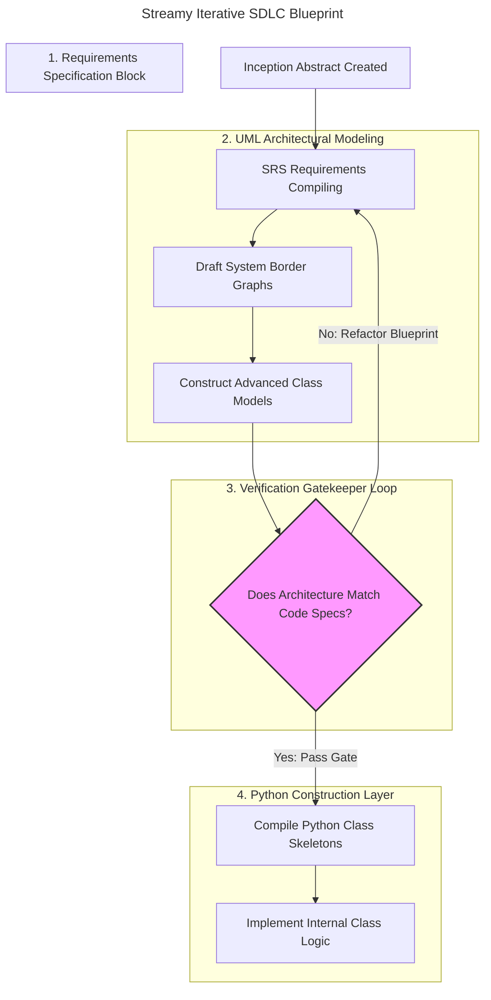
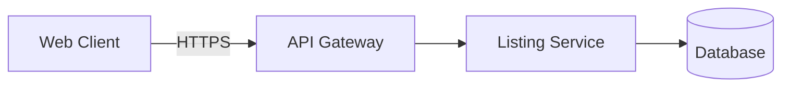
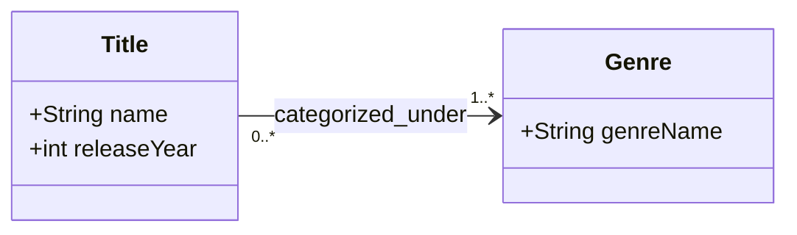
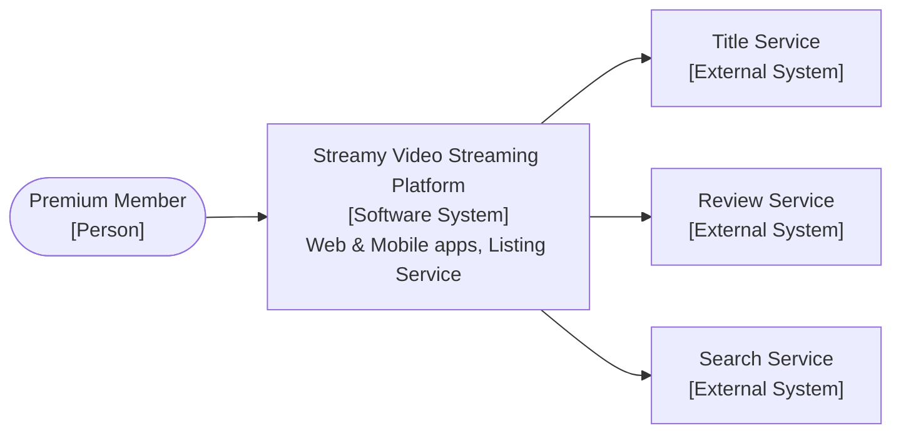

## Streamy Application Engineering Development Lifecycle
To guarantee systematic software tracking across the implementation lifespan of **Streamy**, our individual developer pipeline follows the structured iterative gate review framework illustrated below.

## System Architecture Overview (Native Mermaid)

This repository uses Mermaid for architecture and domain documentation.
The diagram below is rendered natively by GitHub from a fenced `mermaid` code block; changes to the block re-render automatically on commit.

## Diagram Orientation (Direction Control)

Flowchart and class-diagram layout can be controlled directly with a direction directive:

- `TB` / `TD`: Top-to-bottom (default)
- `LR`: Left-to-right
- `RL`: Right-to-left
- `BT`: Bottom-to-top

For class diagrams, place the `direction` keyword inside the diagram body. The example below uses `direction LR`:

## C4 System Context Diagram

The system-level context view shows the Streamy platform and its relationships to its users and external supporting systems:

## Fallback for Platforms Without Native Mermaid Support

On platforms that do not render Mermaid natively (e.g. legacy wikis or standard static sites), keep an exported static image and store the editable diagram source in an HTML comment directly below it, so the source is not lost when the architecture changes later:

<!--
Editable Diagram Source: a flowchart TD with Service A connected to Service B.
Keep the raw Mermaid source here so it is not lost when the architecture changes.
-->
