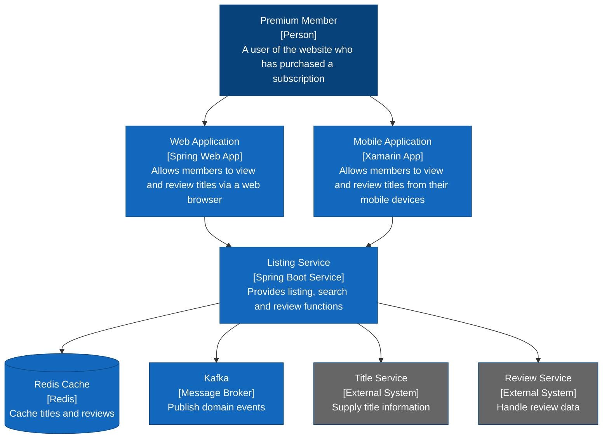

# Architecture: Listing Service C4 Container Diagram

This page carries the C4 container diagram carried over from the earlier labs. It is compiled automatically by the same GitHub Actions pipeline whenever a commit is pushed to `main`.

