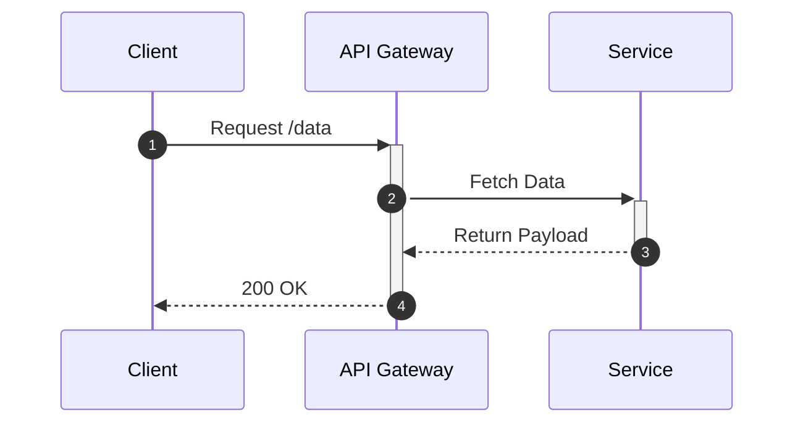

# System Architecture Documentation

Welcome to the automated documentation site for the **Streamy Video Streaming Backend Platform**. This site is built and deployed automatically by GitHub Actions: Markdown files under `docs/` are compiled with Jekyll, and the Mermaid diagram below is rendered in the browser into an inline SVG graphic.

## Service Flow

## About This Pipeline

- **build** job: checks out the repository, compiles the Mermaid diagrams, builds the static site with Jekyll, and uploads the Pages artifact.
- **deploy** job: publishes the uploaded artifact to the GitHub Pages environment.

