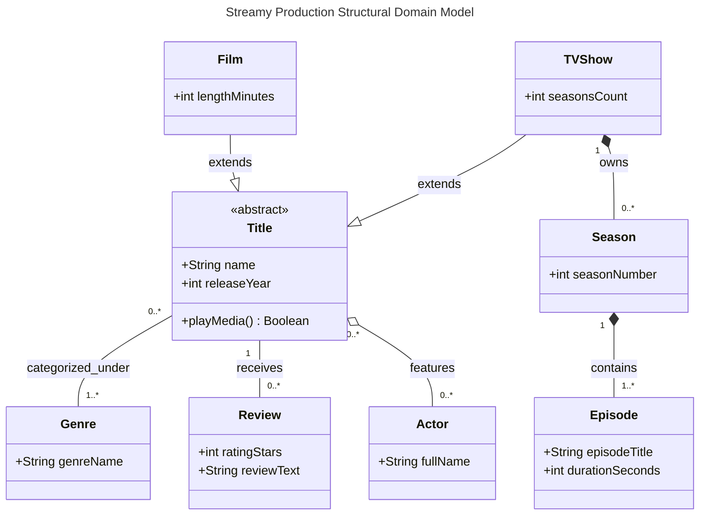

# Streamy Core Domain Structural Architecture

## Advanced Object-Oriented System Entity Specifications
This structural document acts as the definitive blueprint for the Streamy runtime system. It establishes core hierarchies, lifecycle coupling, and cardinality rules, dictating how object models must inherit attributes and clear space allocations out of memory.

### 1. Complex System Relationships Analysis
The domain model uses three structural relationship kinds:

- **Generalization (`--|>`):** `Film` and `TVShow` are specializations of the abstract `Title` and inherit its public attributes and behavior. The hollow triangle points toward the parent class.
- **Composition (`*--`):** Strong whole-part ownership. A `TVShow` owns zero or more `Season` records, and a `Season` owns one or more `Episode` records. The filled diamond sits on the whole side.
- **Aggregation (`o--`):** Weak whole-part sharing. An `Actor` may appear in many titles and has an independent lifecycle, so the hollow diamond links `Title` and `Actor`.

Multiplicity bounds follow the business rules: `1` means exactly one related instance, `0..*` means zero or more, and `1..*` means one or more (at least one).

### 2. Comprehensive Production Class Diagram
The advanced structural design schematic below details all inheritance, composition, and aggregation parameters for the Streamy domain engine:

