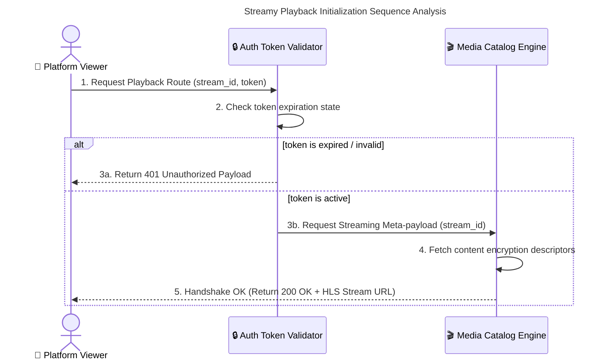
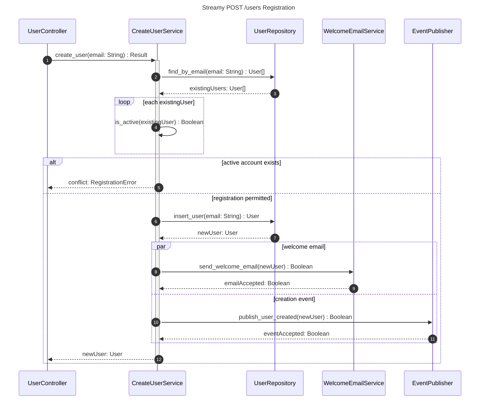
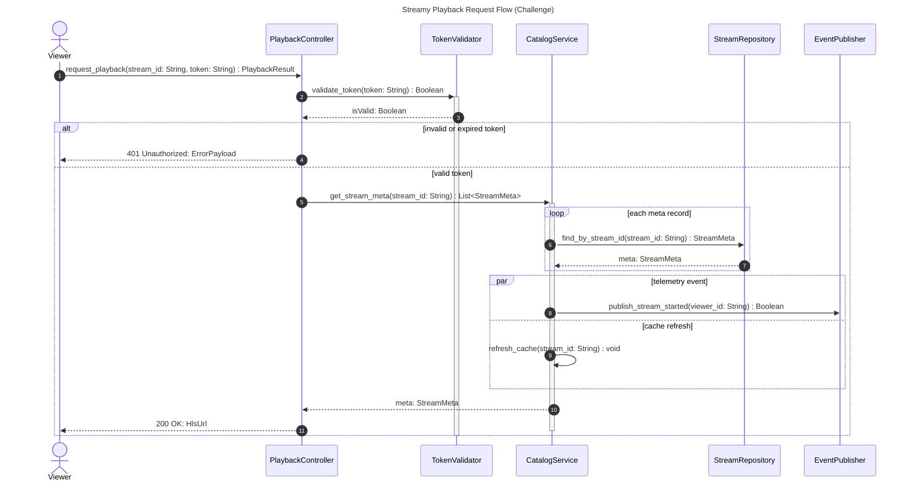

# Streamy Code Flow Sequence Diagrams

## 1. Playback Initialization Sequence Analysis

## 2. Lab 8 Extra: POST /users Account Registration

### 2.1 Registration Sequence (activation, loop, alt/else, par/and)

The registration flow activates the service on entry, loops over matched users to detect active accounts, branches on the duplicate-account outcome with `alt/else`, and runs the welcome email and creation event concurrently inside a `par/and` frame.

### 2.2 Code Smell Analysis

- **Leaky Abstractions:** Iterating over all matched users to identify active accounts may be inefficient. Consider a repository method such as `exists_active_by_email(email)`, supported by appropriate uniqueness rules.
- **Side-Effect Coupling:** Sending email and publishing an event during registration can make retries and partial failures difficult. Consider an event-driven worker and, where needed, a transactional outbox for reliable delivery.

## 3. Challenge: Playback Service Flow Applied to the Streamy Codebase

### 3.1 Participants and Signatures

| Participant | Role | Key methods |
|---|---|---|
| `Viewer` | Platform actor | Initiates the playback request |
| `PlaybackController` | Controller entry point | `request_playback(stream_id: String, token: String) : PlaybackResult` |
| `TokenValidator` | Auth service | `validate_token(token: String) : Boolean` |
| `CatalogService` | Business service | `get_stream_meta(stream_id: String) : List<StreamMeta>` |
| `StreamRepository` | Persistence repository | `find_by_stream_id(stream_id: String) : StreamMeta` |
| `EventPublisher` | Notification dependency | `publish_stream_started(viewer_id: String) : Boolean` |

### 3.2 Sequence Diagram

### 3.3 Observed vs Proposed Behavior

- **Observed in the codebase:** token validation, repository lookup by stream id, and the unauthorized/authorized branching are existing behaviors of the playback flow.
- **Proposed (not yet proven non-blocking):** the `par` frame runs the telemetry event and cache refresh concurrently as an intended design; it does not by itself prove the implementation is non-blocking or retry-safe.
