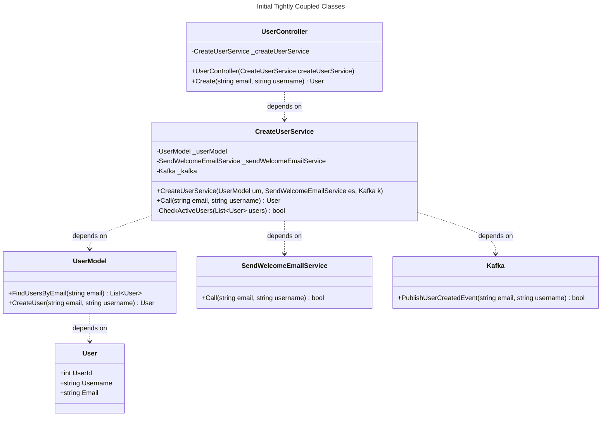
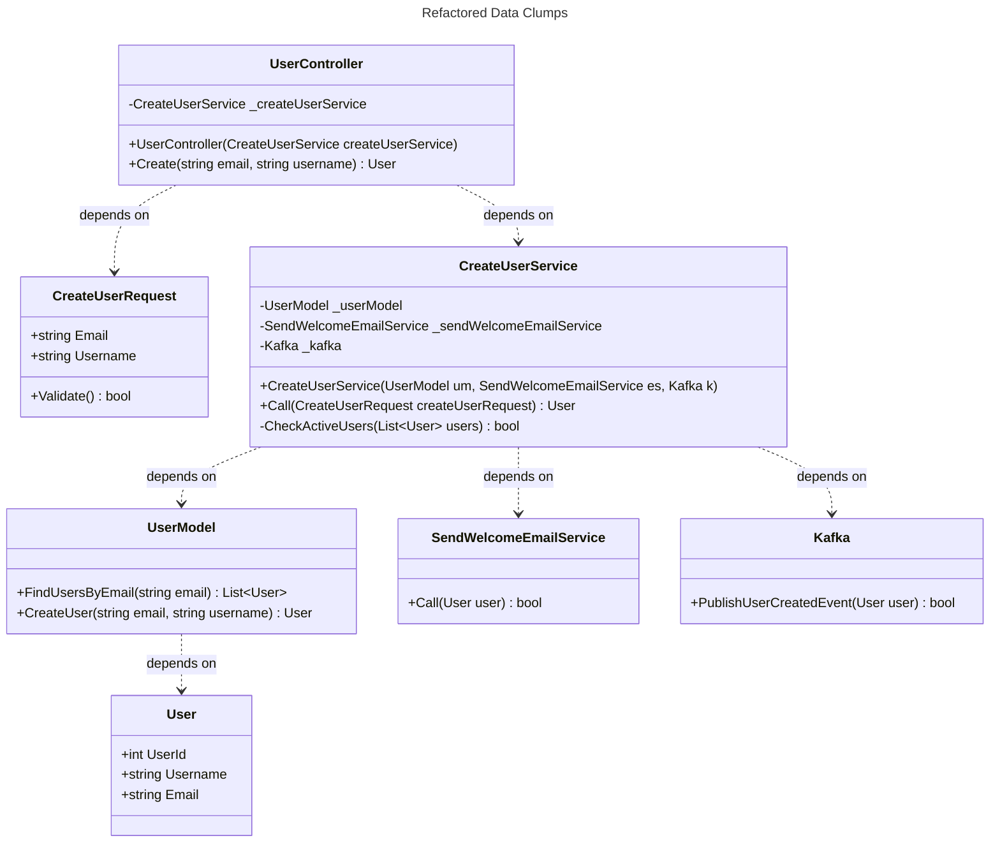
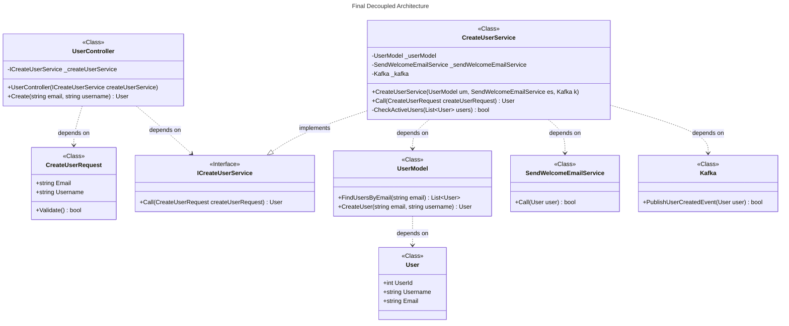
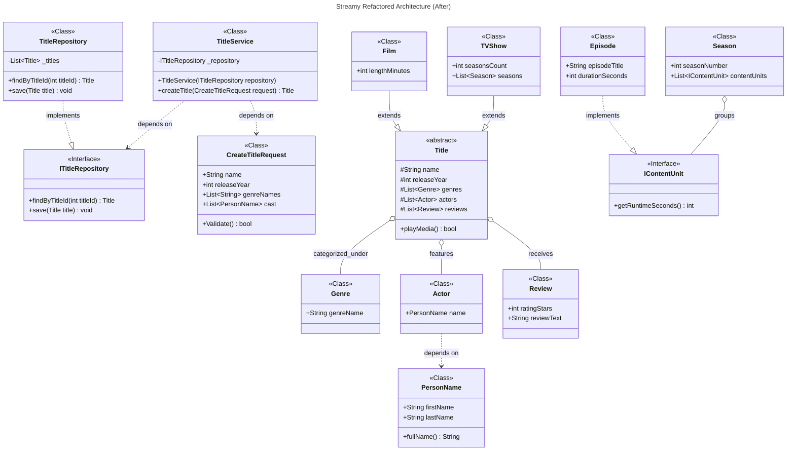

# Streamy UML Class Refactoring: Code Smells, Request Objects and Interface Realization

## Refactoring Analysis
This document models code-level class structures, properties, method signatures, visibility and dependencies with Mermaid class diagrams. It traces two refactoring passes over a tightly coupled user-registration flow: first removing a **Data Clump** by introducing a request object, then inverting the dependency through an interface abstraction (`..|>` realization). The final section applies the same techniques to the Streamy codebase itself.

Visibility convention: `-` private, `+` public, `#` protected. Generics are written with tildes, e.g. `List~User~`. A dashed open arrow `..>` marks a dependency; a dashed hollow triangle `..|>` marks an interface realization.

## 1. Initial Tightly Coupled Classes (Before)
The first diagram shows the original tightly coupled implementation. `string email` and `string username` are passed together across multiple signatures, and the controller depends directly on the concrete service.

## 2. Refactored Data Clumps (Request Object)
The repeated `email + username` pair is a Data Clump. A dedicated `CreateUserRequest` class encapsulates the registration data and self-validates. Downstream services consume the domain entity `User` instead of raw primitives.

## 3. Final Decoupled Architecture (Interface Realization)
`UserController` previously depended directly on the concrete `CreateUserService`. Following the Dependency Inversion Principle, an `ICreateUserService` interface contract is introduced: the controller depends on the interface (`..>`), and the concrete service realizes it (`..|>`).

### Rendering Verification
- Stereotypes `<<Class>>` and `<<Interface>>` render centered at the top of their boxes.
- The relationship between `CreateUserService` and `ICreateUserService` displays as a realization arrow (`..|>`).
- `UserController` has no direct dependency line to the concrete `CreateUserService`.

## 4. Challenge: Refactored Architecture Applied to the Streamy Codebase

### Identified Code Smells
1. **Tight coupling / missing abstraction**: `Season` composes the concrete `Episode`, and `Title` holds concrete `Genre`, `Actor` and `Review` lists. High-level content classes are hard-bound to low-level concrete types; adding a new playable unit would require changing `Season`.
2. **Long parameter list / Data Clump**: creating a title passes a long list of raw parameters (`name`, `releaseYear`, `genres`, `actors`, `reviews`), and `Actor.fullName` stores first and last name as a single raw string.

### After Refactored Architecture
- `ITitleRepository` abstracts persistence; `TitleService` depends on the interface, and `TitleRepository` realizes it.
- `CreateTitleRequest` encapsulates the creation parameters and validates them.
- `IContentUnit` abstracts playable units; `Episode` realizes it, and `Season` depends on the abstraction rather than the concrete episode.
- `PersonName` is a value object replacing the raw name string.

